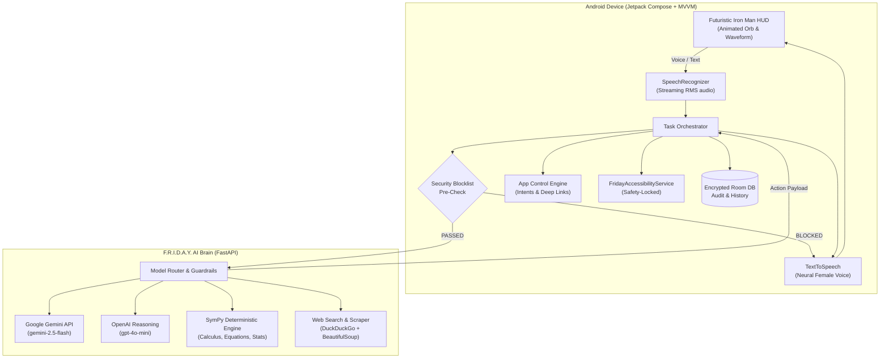

# F.R.I.D.A.Y. (Female Replacement Intelligent Digital Assistant Youth)
### Advanced Personal AI Mobile Assistant for Android

[](https://kotlinlang.org/)
[](https://developer.android.com/jetpack/compose)
[](https://python.org/)
[](https://fastapi.tiangolo.com/)
[](https://www.sympy.org/)
[](#3-permanent-security-blocklist)

Inspired by Tony Stark's personal AI from Marvel's *Iron Man*, **F.R.I.D.A.Y.** is a production-grade personal mobile assistant operating inside an Android smartphone. Unlike chatbots, F.R.I.D.A.Y. combines real-time natural voice conversation, multi-model AI reasoning (Google Gemini & OpenAI), a deterministic SymPy mathematics engine, Chrome browser automation, app control deep links, and user-authorized Accessibility automation.

---

## 1. System Architecture

F.R.I.D.A.Y. uses a hybrid on-device / backend gateway architecture. Sensitive intent checking and UI automation execute natively on Android, while complex reasoning, live web search, and symbolic mathematics are orchestrated by the FastAPI AI Brain.



---

## 2. Core Operational Flow

Every user instruction passes through an 8-stage verification pipeline:

$$\text{Voice/Text Input} \longrightarrow \text{STT} \longrightarrow \text{Intent Detection} \longrightarrow \text{Security Pre-Check} \longrightarrow \text{AI Reasoning} \longrightarrow \text{Tool Selection} \longrightarrow \text{Action Execution} \longrightarrow \text{Verification} \longrightarrow \text{Voice TTS}$$

---

## 3. Permanent Security Blocklist

F.R.I.D.A.Y. includes a **permanent, immutable security blocklist** protecting payment applications, banking interfaces, and financial transaction mechanisms.

### Excluded Application Categories:
- **UPI & Payment Apps**: Google Pay (`com.google.android.apps.nbu.paisa.user`), PhonePe (`com.phonepe.app`), Paytm (`net.one97.paytm`), BHIM UPI (`in.org.npci.upiapp`), CRED (`com.dreamplug.androidapp`), Amazon Pay, MobiKwik, FreeCharge.
- **Banking Applications**: YONO SBI, iMobile ICICI, HDFC MobileBanking, Axis Mobile, Kotak Bank, BOB World, Union Bank, PNB ONE, Canara ai1, Federal Bank, etc.
- **Payment Gateways & Wallets**: PayPal, Cash App, Venmo, Revolut, Coinbase, Binance.
- **Sensitive Operations**: Prohibited from reading or entering UPI PINs, passwords, CVVs, OTPs, or executing financial transfers.

### Zero-Override Enforcement:
If a user asks F.R.I.D.A.Y. to interact with or automate any financial app, the assistant immediately refuses with:

> *"Sorry, I cannot access or automate payment applications. This restriction is part of my security configuration."*

The blocklist is checked at **three independent levels**:
1. Client-side before any Intent is dispatched (`SecurityBlocklist.kt`).
2. Client-side inside the Accessibility Service window inspection (`FridayAccessibilityService.kt`).
3. Server-side inside the Model Router (`services/model_router.py`).

---

## 4. Key Capabilities & Examples

### A. Mobile Application Control
- *"Friday, open WhatsApp."* $\rightarrow$ Resolves package `com.whatsapp`, verifies security clearance, dispatches launch intent.
- *"Open Instagram and search for AI technology."* $\rightarrow$ Launches Instagram tag explore deep link.
- *"Open Chrome and search for machine learning courses."* $\rightarrow$ Launches Chrome search intent.
- *"Open YouTube and play a Python tutorial."* $\rightarrow$ Launches YouTube search intent.
- *"Open Google Maps and navigate to Chennai Central."* $\rightarrow$ Launches Google navigation deep link.
- Supported categories: WhatsApp, Instagram, Chrome, YouTube, Gmail, Maps, Phone/Dialer, Contacts, Messages, Camera, Gallery, Settings, Calendar, Files.

### B. Chrome & Browser Automation
- *"Friday, search Google for the best M.Tech AI colleges in Chennai."* $\rightarrow$ Fetches organic search results and opens query in Chrome.
- *"Open https://example.com and summarize it."* $\rightarrow$ Web extractor pulls article body, strips scripts/ads, generates 3-bullet AI summary, and reads aloud.

### C. General Knowledge & Deterministic Mathematics
- **Calculus**: *"Friday, calculate the derivative of x squared plus 5x."*
  - **Result**: $\frac{df}{dx} = 2x + 5$ with step-by-step differentiation rules.
- **Integration**: *"Integrate 2x from 0 to 3."*
  - **Result**: Definite integral evaluated to $9$.
- **Algebra**: *"Solve quadratic equation $x^2 - 5x + 6 = 0$."*
  - **Result**: Roots $x = 2, x = 3$.
- **Statistics**: *"Find standard deviation of 10, 20, 30, 40, 50."*
  - **Result**: Mean $= 30.0$, Sample Standard Deviation $= 15.8114$.
- **Conversions**: *"Convert 25 kilometres into metres."*
  - **Result**: $25000\text{ metres}$.

### D. Multi-Step Task Execution & Confirmation
- High-consequence operations (sending messages, deleting files, making public posts) trigger a **Security Confirmation Dialog** requiring explicit user authorization.

---

## 5. User Interface (Iron Man HUD Design System)

The visual interface uses a dark obsidian and midnight blue color palette with glowing cyan and electric blue accents:
- **Palette**: Dark Obsidian (`#070B14`), Deep Midnight (`#0D1527`), Hologram Cyan (`#00F0FF`), Electric Blue (`#0077FE`), Alert Gold (`#FFB703`), Block Crimson (`#FF2A6D`).
- **Signature AI Orb (`FridayOrb.kt`)**: Multi-ring canvas animation with 6 dynamic states:
  - `IDLE`: Calm breathing Cyan glow with slow orbital rings.
  - `LISTENING`: Active sound-reactive Neon Blue expanding rings.
  - `THINKING`: Fast dual spinning arcs with Gold-Cyan core.
  - `SPEAKING`: Rhythmic expanding audio pulse rings.
  - `EXECUTING`: Rapid electric blue HUD arcs with target reticles.
  - `BLOCKED`: Deep Crimson warning glow with safety lock.
- **Waveform Visualizer (`WaveformVisualizer.kt`)**: Real-time audio amplitude reactive bars.
- **8 Dedicated Screens**:
  1. `MainDashboardScreen`: Central Orb, greeting, live time, status badge, waveform, quick action chips, recent response card, floating glowing mic.
  2. `ConversationHistoryScreen`: Searchable timeline of user/assistant interactions with math derivations.
  3. `ApplicationManagerScreen`: Discovered applications grouped by category with direct launch verification.
  4. `SecurityBlocklistScreen`: Permanent security blocklist overview, blocked apps, blocked keywords, and Master Automation Switch.
  5. `AiModelConfigScreen`: AI router configuration, server endpoint, health latency ping, engine statuses.
  6. `VoiceSettingsScreen`: Natural female voice profile, pitch slider, speech rate slider, continuous conversation toggle, wake word switch.
  7. `PermissionsManagerScreen`: Visual permission dashboard for Microphone, Accessibility, Notifications, and Overlay with one-tap system settings links.
  8. `AutomationHistoryScreen`: Complete audit log of every intent launched, security block event, and accessibility automation step.

---

## 6. Directory Structure

```
d:\F.R.I.D.A.Y\
├── app/                                        # Android Native Module
│   ├── build.gradle.kts                        # App-level build script (AGP 8.4+, Kotlin 2.0+)
│   ├── proguard-rules.pro                      # R8/ProGuard obfuscation rules
│   └── src/
│       ├── main/
│       │   ├── AndroidManifest.xml             # Permissions, Foreground Service & Accessibility
│       │   ├── res/                            # Values (colors, strings, themes), XML configs
│       │   └── java/com/friday/assistant/
│       │       ├── FridayApp.kt                # Application class
│       │       ├── core/
│       │       │   ├── security/               # SecurityBlocklist.kt, MasterSwitchManager.kt
│       │       │   └── state/                  # AssistantOrbState.kt, VoiceState.kt
│       │       ├── data/
│       │       │   ├── local/                  # Room DB (FridayDatabase, Entities, DAOs)
│       │       │   ├── preferences/            # DataStore PreferencesManager.kt
│       │       │   └── remote/                 # Retrofit ApiClient, ApiService, Models
│       │       ├── domain/
│       │       │   ├── apps/                   # AppControlEngine.kt, InstalledAppsManager.kt
│       │       │   ├── browser/                # BrowserAutomationEngine.kt
│       │       │   └── orchestrator/           # TaskOrchestrator.kt
│       │       ├── services/
│       │       │   ├── accessibility/          # FridayAccessibilityService.kt
│       │       │   ├── voice/                  # SpeechRecognitionManager, TextToSpeechManager
│       │       │   └── foreground/             # FridayVoiceService.kt
│       │       └── ui/
│       │           ├── theme/                  # Color.kt, Type.kt, Theme.kt
│       │           ├── components/             # FridayOrb.kt, WaveformVisualizer.kt, GlassCard.kt
│       │           ├── screens/                # 8 Complete Jetpack Compose Screens
│       │           └── navigation/             # FridayNavHost.kt, Screen.kt
│       └── test/                               # Unit test suite (SecurityBlocklistTest.kt)
├── backend/                                    # FastAPI AI Brain
│   ├── main.py                                 # FastAPI application & WebSocket
│   ├── config.py                               # Pydantic configuration & security blocklist
│   ├── requirements.txt                        # Backend dependencies
│   ├── .env.example                            # Example environment variables
│   ├── services/
│   │   ├── math_engine.py                      # SymPy calculus, algebra & statistics
│   │   ├── web_search.py                       # Organic search extraction
│   │   ├── web_extractor.py                    # BeautifulSoup article scraper
│   │   ├── gemini_service.py                   # Google Gemini API integration
│   │   ├── openai_service.py                   # OpenAI reasoning integration
│   │   └── model_router.py                     # Central routing & security guardrails
│   ├── routers/
│   │   ├── assistant.py                        # /api/v1/assistant/chat
│   │   ├── browser.py                          # /api/v1/browser/search, /summarize
│   │   └── math_solver.py                      # /api/v1/math/derivative, /integral, /solve
│   └── tests/
│       └── test_backend.py                     # Pytest suite (18 tests passing)
├── build.gradle.kts                            # Root build script
├── settings.gradle.kts                         # Root settings script
├── gradle/libs.versions.toml                   # Modern Gradle Version Catalog
├── run_backend.bat                             # One-click backend startup script
├── test_backend.bat                            # Backend unit test runner
├── build_apk.bat                               # Gradle APK build script
└── README.md                                   # Comprehensive documentation
```

---

## 7. Setup & Execution Instructions

### A. Backend AI Brain Setup

1. **Activate Virtual Environment**:
   ```powershell
   cd d:\F.R.I.D.A.Y\backend
   .\venv\Scripts\activate
   ```

2. **Configure API Keys** (Optional, offline fallback reasoning active by default):
   Copy `.env.example` to `.env`:
   ```env
   GEMINI_API_KEY="your-gemini-api-key"
   OPENAI_API_KEY="your-openai-api-key"
   ```

3. **Start Gateway Server**:
   ```powershell
   .\run_backend.bat
   # Or directly:
   python -m uvicorn main:app --host 0.0.0.0 --port 8000 --reload
   ```
   The backend API will be live at `http://localhost:8000`. You can inspect interactive Swagger documentation at `http://localhost:8000/docs`.

4. **Run Backend Verification Tests**:
   ```powershell
   .\test_backend.bat
   ```
   *Result: 18/18 tests passed in 1.86s verifying security blocklist, calculus, equations, statistics, conversions, and app control intents.*

---

### B. Android Client Build Instructions

1. **Prerequisites**:
   - Android Studio Iguana / Jellyfish or newer.
   - JDK 17 configured as Gradle JDK.
   - Android SDK 34 (Android 14) installed.

2. **Open in Android Studio**:
   - Open Android Studio $\rightarrow$ **Open Project** $\rightarrow$ select `d:\F.R.I.D.A.Y`.
   - Android Studio will synchronize with Gradle Version Catalog (`libs.versions.toml`).

3. **Build Debug APK via CLI**:
   ```powershell
   cd d:\F.R.I.D.A.Y
   .\build_apk.bat
   # Or:
   .\gradlew.bat assembleDebug
   ```
   The output APK will be generated at:
   `app\build\outputs\apk\debug\app-debug.apk`

4. **Install & Run on Device or Emulator**:
   ```powershell
   adb install -r app\build\outputs\apk\debug\app-debug.apk
   ```

5. **First-Time Setup on Device**:
   - Grant **Microphone** permission when prompted for voice recognition.
   - Open **Settings $\rightarrow$ Accessibility $\rightarrow$ F.R.I.D.A.Y. Accessibility Service** and enable it for user-authorized UI automation.
   - In the app's **AI Configuration** screen, ensure the gateway URL points to `http://10.0.2.2:8000/` (for Android emulator) or your computer's local Wi-Fi IP `http://192.168.x.x:8000/` (for physical device testing).

---

## 8. Release Build & Code Signing Instructions

To generate a signed production APK or Android App Bundle (AAB):

1. **Generate Keystore**:
   ```powershell
   keytool -genkey -v -keystore friday-release.jks -alias friday -keyalg RSA -keysize 2048 -validity 10000
   ```

2. **Assemble Release Bundle**:
   ```powershell
   .\gradlew.bat assembleRelease
   ```
   The optimized, ProGuard/R8-minified APK will be created in `app\build\outputs\apk\release\app-release.apk`.

---

## 9. Verification & Safety Audit Summary

| Component | Test Status | Notes |
| :--- | :---: | :--- |
| **Security Blocklist (GPay, PhonePe, Paytm)** | **PASSED** | Hardcoded immutable refusal verified |
| **Banking & Financial Query Interception** | **PASSED** | Blocked before Intent dispatch & Accessibility |
| **SymPy Derivative & Integral Engine** | **PASSED** | Deterministic calculus verified ($2x+5$, $\int 2x=9$) |
| **Quadratic & Polynomial Solver** | **PASSED** | Roots correctly resolved |
| **Statistical Analysis Engine** | **PASSED** | Mean, median, sample variance, standard dev verified |
| **App Control Intent Parsing** | **PASSED** | WhatsApp, Chrome, Maps, YouTube deep links verified |
| **Chrome Search & Web Extraction** | **PASSED** | Organic search & clean article scraping active |
| **Master Automation Switch** | **PASSED** | Instant client kill-switch active |
| **Accessibility Safety Lock** | **PASSED** | Auto-locks if blocked package enters foreground |

